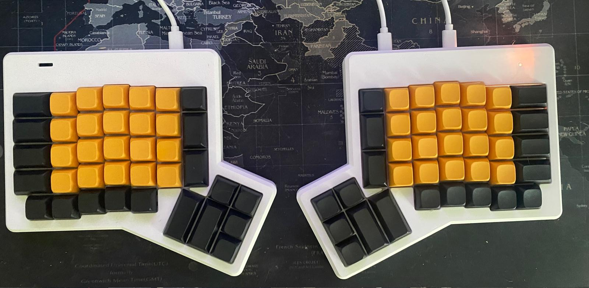
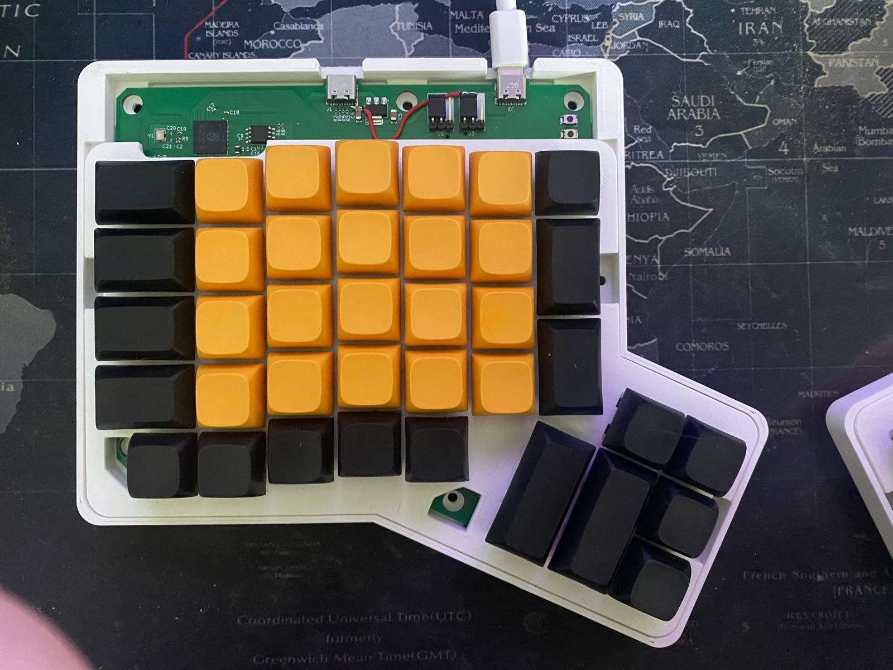
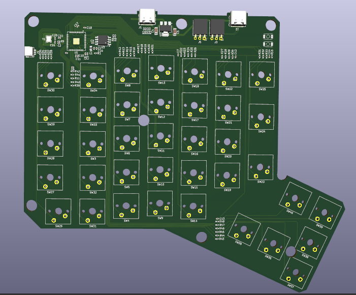
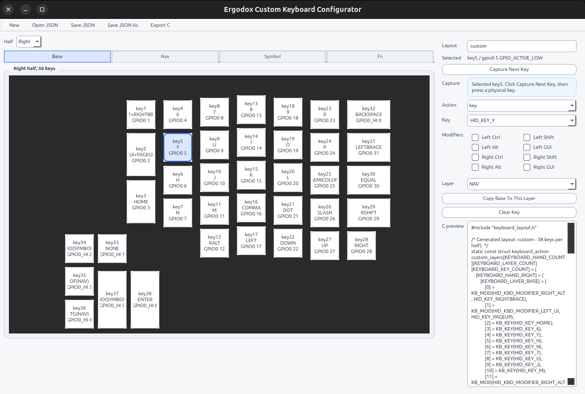

# ErgoDox Custom Keyboard

## 1. Introduction

This project is a custom split ErgoDox-style keyboard built around the RP2350
and Zephyr RTOS.

The goal is not only to build a working keyboard. It is also a learning project
for KiCad, PCB design, electronic development, Zephyr, USB HID, and split
keyboard firmware. The RP2350 is clearly more powerful than a keyboard needs,
but that is part of the fun: it gives enough room to experiment without being
limited by the controller.

The firmware is designed to keep the time between a physical key press and the
USB HID report as small as reasonably possible. Keys are scanned through direct
GPIO interrupts with debounce handling, then converted into USB HID keyboard
reports by the active half.

The keyboard is split into two hands. One half is connected to the computer over
USB and acts as the HID keyboard. The other half sends its key events over UART
to the USB-connected half.



## 2. Project Structure

The repository contains the mechanical, electronic, and firmware parts of the
keyboard.

### Mechanical files

`hardware/mechanical` contains the STL files for the printed case parts. The
current files are for the right hand; the left-hand mechanical design is made by
mirroring the right-hand design.

### Electronic files

`hardware/electronic` contains the KiCad projects for the PCBs:

- `LeftHand.kicad_pro`: left-hand PCB project;
- `RightHand.kicad_pro`: right-hand PCB project;
- `ErgoDoxCustom.kicad_pro`: shared/root KiCad project files;
- `production/v1`: generated fabrication and assembly files.

The production files were prepared for JLCPCB assembly, and the BOM contains
JLCPCB/LCSC component references. More hardware-specific notes are documented in
`hardware/electronic/README.md`.





### Zephyr firmware

The root of the repository is a Zephyr application for the RP2350:

- `CMakeLists.txt`: Zephyr application definition and target board;
- `prj.conf`: main firmware configuration;
- `Kconfig`: keyboard hand, layout, and split UART options;
- `app.overlay`: GPIO, LED, USB HID, and UART device tree configuration;
- `src/main.c`: key scanning, USB HID, split transport selection, and LED state;
- `src/keyboard_runtime.c`: layer and HID report runtime;
- `src/keyboard_layouts.c` and `src/custom_layout.c`: keyboard layouts;
- `src/split_transport_uart.c`: UART transport between the two halves;
- `layouts`: JSON layout descriptions;
- `scripts/keyboard_configurator.py`: helper UI for generating custom layouts.

## 3. How To Get Started

### Build with Docker (Linux, macOS, or Windows)

Install Docker Engine on Linux, or Docker Desktop with Linux containers on
macOS/Windows. No host Zephyr, Python, CMake, or compiler installation is needed.
Run this command from the repository root (the same command works in PowerShell):

```sh
docker compose run --build --rm build
```

Compose builds the dependency image, mounts the repository at `/workspace`, and
builds both keyboard halves. Image layers are cached. After the first build,
you can skip the image-build check with `docker compose run --rm build`.
Firmware builds run with networking disabled; image creation can access the
internet to download dependencies.

The container runs as UID/GID `1000:1000` by default. If your Linux account uses
different IDs, set `BUILD_UID` and `BUILD_GID` in a local `.env` file, using the
values printed by `id -u` and `id -g`. For a single invocation, you can use:

```sh
BUILD_UID=$(id -u) BUILD_GID=$(id -g) docker compose run --rm build
```

The Ubuntu 26.04 image contains the official Zephyr v4.5.0 stable release, its
RP2350 modules, Python build dependencies, and Zephyr SDK 1.0.1 with the ARM GNU
toolchain. The first image build needs internet access; subsequent firmware
builds use the installed dependencies and can run offline. Docker selects the native Linux architecture
on x86-64 and ARM64 hosts, including Apple Silicon.

Zephyr v4.5.0 is a stable release, not an LTS release. The current 3.7 LTS
series predates RP2350 support and cannot build this board without backports.

Both halves are built together. The final build step exports both UF2 files to
the build directory root, written back to the mounted repository. The exports
are refreshed on every successful build, even when their content is unchanged:

- `build/docker/ergodox_left.uf2`
- `build/docker/ergodox_right.uf2`

The separate `build/docker` directory avoids reusing a host build's CMake cache.
Use these commands for a clean build or an interactive development shell:

```sh
docker compose run --rm build build -p always
docker compose run --rm build bash
```

Inside that shell, the repository is `/workspace`, and the installed west
workspace is `/opt/zephyr-workspace`.

To move to another machine, clone the repository and repeat the commands above.
You can also transfer the built image without rebuilding its dependencies:

```sh
docker save -o ergodox-build.tar ergodox-build
# On another machine with the same CPU architecture:
docker load -i ergodox-build.tar
```

The Zephyr release tag and SDK version are defined by build arguments in `Dockerfile`.
Rebuild the image when changing dependencies; application source edits only need
another `docker compose run --rm build`. The Python packages and Ubuntu packages are resolved when
the image is built, so transferring the image also preserves those exact versions.
Flashing remains a host operation: copy each UF2 to the corresponding half in
BOOTSEL mode.

### Build with a host Zephyr installation

Install Zephyr and make sure `west` is available in your shell. This project is
built as a Zephyr application, so it expects the usual Zephyr SDK and Python
environment to be installed first.

From the project directory, build both keyboard halves with sysbuild:

```sh
west build --sysbuild -b rp2350b_core/rp2350b/m33
```

The board is also set in `CMakeLists.txt`, so the board argument can be omitted
once the Zephyr workspace is configured:

```sh
west build --sysbuild
```

Sysbuild compiles the application twice and selects the hand independently for
each image. The resulting UF2 files are:

```text
build/ergodox_left.uf2
build/ergodox_right.uf2
```

Flash the generated firmware using your RP flash hardware tool. The exact
command depends on the probe and runner you use, but the usual Zephyr entry
point is:

```sh
west flash --domain ergodox_left --openocd /usr/local/bin/openocd
```

Flash the right half by selecting its sysbuild domain:

```sh
west flash --domain ergodox_right --openocd /usr/local/bin/openocd
```

The USB-connected half will enumerate as the keyboard; the other half will fall
back to UART and forward its key events.

## 4. How To Create A Custom Design

Start with the layout. The firmware supports multiple hands and layers through
`src/keyboard_layout.h`. You can edit the C layout files directly, or use the
layout JSON files and `scripts/keyboard_configurator.py` to generate a custom
layout.



Useful places to change behavior:

- `layouts/custom.json`: custom layout source data;
- `src/custom_layout.c`: generated/custom C layout;
- `Kconfig`: available layout choices;
- `prj.conf`: selected hand and selected layout;
- `app.overlay`: GPIO mapping, LED pins, USB HID device, and split UART pins.

The configurator separates localized keyboard keys from special actions. Select
one of the dedicated action types for:

- consumer controls such as volume, playback, display brightness, browser,
  mail, and calculator;
- system power, sleep, and wake controls;
- mouse buttons, cursor movement, and vertical scrolling;
- keyboard lighting toggle, on/off, and brightness controls.

The generated layout uses `KB_CONSUMER`, `KB_SYSTEM`, `KB_MOUSE_*`, and
`KB_LIGHTING` macros. Keyboard, consumer, system, and mouse reports share one
HID interface and use report IDs to distinguish them. In boot protocol, only the standard eight-byte
keyboard report is sent, without a report ID. The current board drives its four
indicator LEDs as binary GPIOs, so lighting brightness up/down maps to enabled/disabled rather
than PWM dimming.

For example, exported volume keys now look like:

```c
KB_CONSUMER(HID_CONSUMER_VOLUME_INCREMENT)
KB_CONSUMER(HID_CONSUMER_VOLUME_DECREMENT)
```

For electronic changes, open the KiCad projects in `hardware/electronic`. The
left and right hands are separate projects, so changes that affect both halves
should be applied and checked on both PCBs.

For mechanical changes, start from `hardware/mechanical`. The current case files
are based on a modified right-hand design; mirror or adapt them for the left
hand as needed.

Before producing a new hardware revision:

- update the KiCad schematic and PCB;
- run electrical rules and design rules checks;
- regenerate the BOM, position files, designator files, netlist, and fabrication
  ZIP;
- store the generated files under a new production revision folder;
- update the hardware README with any known fixes or ordering notes.

## 5. How To Contribute

Contributions are welcome, especially in areas that make the keyboard easier to
build, flash, customize, or manufacture.

Good contribution topics include:

- firmware fixes and latency improvements;
- layout improvements;
- Zephyr configuration cleanup;
- KiCad schematic or PCB fixes;
- mechanical case improvements;
- clearer build, flashing, and production documentation.

When contributing, avoid committing local generated noise such as `build/`,
Python `__pycache__` folders, KiCad lock files, or editor-specific files.
Production files are useful to commit when they represent a real hardware
revision that was ordered or is ready to order.

### USB web configurator (prototype)

The `ergodox,configurator` node in `app.overlay` defines the local boot chord:

```dts
configurator {
    compatible = "ergodox,configurator";
    gpios = <&gpio0 1 (GPIO_ACTIVE_LOW | GPIO_PULL_UP)>,
            <&gpio0 2 (GPIO_ACTIVE_LOW | GPIO_PULL_UP)>;
};
```

Hold every listed input active while powering up. The default is physical keys
1 and 2 on the same half. Polarity and pulls come from each GPIO specifier.
The firmware samples the entire chord repeatedly over 20 ms before starting USB,
UART, or key interrupts. Partial chords continue normal boot. GPIO errors stop
boot rather than treating a failed read as a pressed key. Set `status = "disabled"`
or remove the node to disable this feature. Only one enabled node is supported.
Chords spanning both halves are not supported.

When the chord is held on the USB-connected half at boot, the keyboard enumerates
as **Ergodox Configurator**, a USB CDC-NCM Ethernet device. Its address is
`192.168.7.1/24`; a DHCP server offers the computer `192.168.7.2/24`, without a
default gateway or DNS server. Open **http://192.168.7.1/** to view the current layout, both physical keyboard
halves, and their layers. Select a key to inspect its action. Download the layout
as JSON or import a JSON layout file. Uploaded files are validated and
previewed before **Save to keyboard** writes NVM; reboot to apply the saved
layout. No internet connection or additional web server is needed. See the
[JSON file format](docs/layout-json.md).
The firmware loads a validated RAM layout
from NVM, with compiled factory defaults as fallback. See [configuration formats](docs/keyboard-configuration.md).

On Linux, the host uses the `cdc_ncm` driver. Allow the new Ethernet connection
to obtain an IPv4 address automatically. If the host does not run DHCP on the
new interface, assign it `192.168.7.2` with subnet mask `255.255.255.0` manually,
leaving the gateway and DNS empty. Avoid using another network with the same
subnet during configuration. Other operating systems need a compatible CDC-NCM
driver; compatibility has not yet been verified on hardware.

Configuration mode exposes only USB networking and does not send keyboard
reports. It scans the local keys and receives raw key events from the slave over
UART so the viewer can highlight physical presses on both halves at up to 20 Hz.
The slave must boot normally; hold the boot chord only on the USB-connected half. Normal keyboard boot excludes the USB
network function and does not start DHCP or HTTP. Release the chord and reconnect
USB to return to keyboard mode. RTT logs report service startup or failures.

### Logs through the SWD debug port (RTT)

Both halves send Zephyr logs on RTT channel 0. Connect the Raspberry Pi Debug
Probe's **D** port to the target's SWD debug connector (SWCLK, SWDIO, GND) and
power the keyboard normally. UART wiring is not needed.

Rebuild the Docker image once to download the manifest-pinned SEGGER module,
then flash the new firmware on the half you want to inspect:

```sh
docker compose run --build --rm build
```

For a host Zephyr installation, run `west update segger` before rebuilding.
Use a host OpenOCD installation with RP2350 and RTT support. Start it with:

```sh
openocd -f interface/cmsis-dap.cfg -f target/rp2350.cfg \
  -c "adapter speed 5000" \
  -c "init" \
  -c "targets rp2350.cm0" \
  -c "rtt setup 0x20000000 0x82000 {SEGGER RTT}" \
  -c "rtt start" \
  -c "rtt server start 19021 0"
```

In another terminal, read the logs:

```sh
nc localhost 19021
```

The search range covers the RP2350's 520 KiB SRAM. OpenOCD attaches to the
running firmware without deliberately resetting it. The 4 KiB RTT buffer holds
recent logs; messages are dropped when full so an absent debugger does not block
normal operation. Only the half connected to the probe is visible. To repeat
startup messages, reset the target and restart the OpenOCD RTT session if needed.

If OpenOCD reports that no RTT control block is found, verify that the flashed
firmware contains RTT and that the target is running. A shared-library error
before OpenOCD starts indicates a host OpenOCD installation problem.
